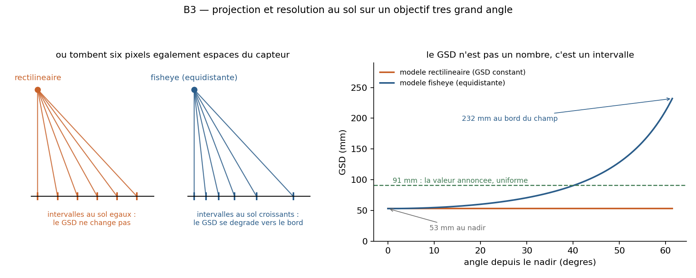
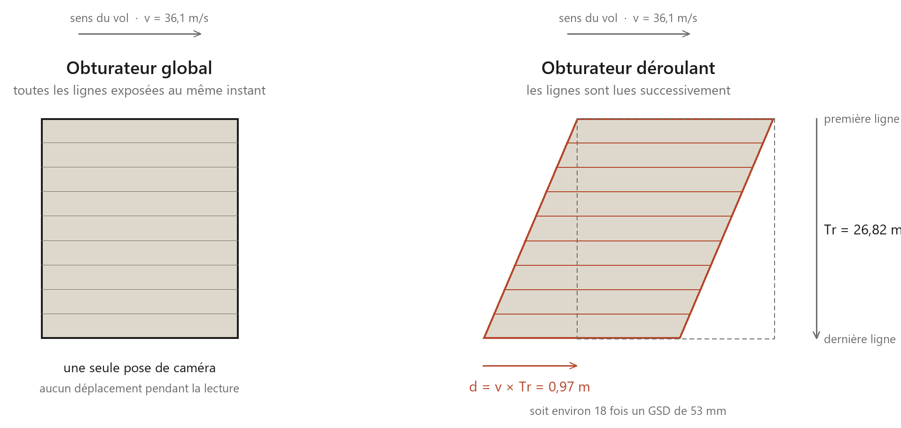
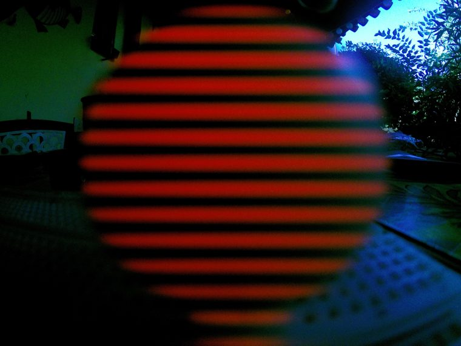
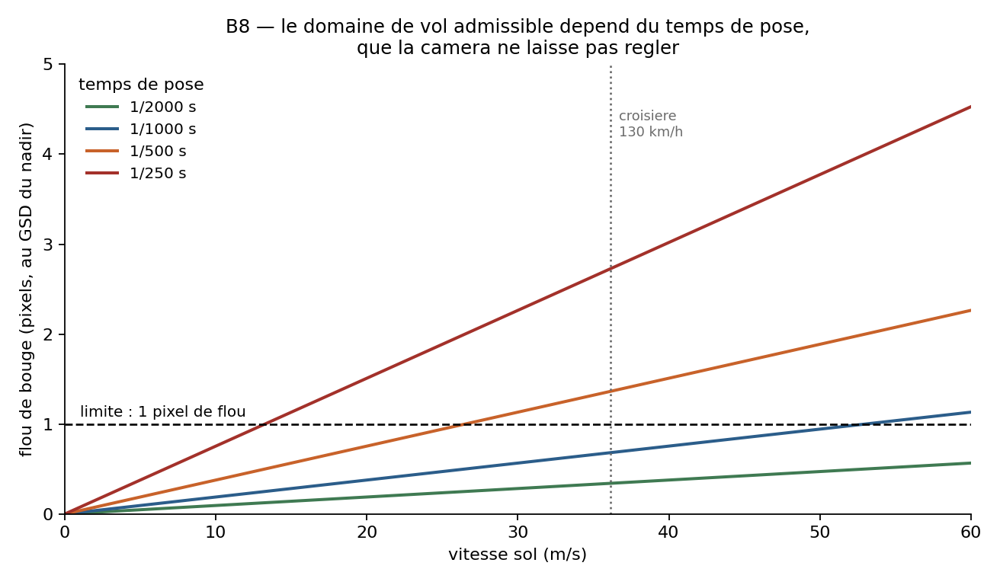

# Can a GoPro make an orthophoto? Measuring the readout time of an action camera

**Language / Langue :** 🇬🇧 English · 🇫🇷 [Français](README.md)

## The starting point

An action camera costs a few hundred euros, a photogrammetric camera several
tens of thousands. The difference is not only resolution: an action camera does
not come with the geometric guarantees that mapping requires.



**Figure 1 — Rectilinear projection and fisheye model: GSD varies across the
field.** The values 53 mm and 232 mm are computed for the configuration shown,
not measured on an orthophoto. Author's calculations.

The question this repository asks is therefore a simple one:

> **can a GoPro take a series of images from which an orthophoto can be
> derived, and under what conditions?**

Answering it needs a value that is nowhere to be found: the **sensor readout
time**. Most action cameras do not capture the whole image at once: they read
the sensor line by line, from top to bottom — the rolling shutter. If the camera
moves during that readout, the image is distorted. OpenDroneMap can correct that
distortion, but only if it knows the readout time, and it holds no value for the
HERO4 Silver or the HERO13 Black. Borrowing another model's value assumes that
two sensors are read the same way.



**Figure 2 — Simultaneous or successive reading of the sensor.** At 36.1 m/s, a
26.82 ms readout corresponds to 0.97 m of platform displacement; this distance
is not the error measured on the orthophoto. Author's diagram and calculations.

So I built a measurement bench. This repository holds the bench, its protocol,
the programs that analyse the photographs, the values obtained, and a test
flight that checks the result under real conditions.

## How the bench works

An LED blinks at a known frequency. Because the sensor's lines are read one
after another, each line sees the LED in a different state, on or off. The
photograph then shows horizontal bands. Counting the bands over the height of
the image gives the time between the reading of the first line and that of the
last:

$$t_{\text{readout}} = \frac{N}{f}$$

where *N* is the number of bands counted over the height of the image and *f*
the frequency of the LED.



**Figure 3 — LED bench for measuring the readout time of the HERO4 Silver.**
The light bands give the time offset between the sensor's lines; detailed
protocol in
[annexe B](docs/annexes.en.md#annexe-b--protocoles-de-mesure-reproductibles).
Author's photograph.

The principle is simple, but the conditions under which it works are not
obvious: it took me three failed series before the first usable measurement.

## What I measured

| Camera | Capture mode | Readout time |
|---|---|---|
| GoPro HERO4 Silver | single photo, wide field, 12 Mpx | **27.01 ms** |
| GoPro HERO4 Silver | single photo, medium field, 7 Mpx | **18.29 ms** |
| GoPro HERO4 Silver | Time Lapse 1 s | **26.9 ms** |
| GoPro HERO13 Black | Wide and Linear, 27 Mpx | **20.8 ms** |

The most important result: **the readout time follows the field of view
selected, not the resolution of the file.** In wide field, 12 Mpx and 7 Mpx give
the same value to within half a per cent (27.01 and 26.86 ms). In medium field,
a third is lost (18.29 ms): the sensor then reads only about 68 % of its height,
and the resolution is merely a downsampling applied after the readout.

Worth remembering: a readout time should never be quoted for a camera model
alone, without stating the capture mode.

## The bench, in your browser

👉 **[Open the bench](https://renouxfabrice.github.io/action-camera-orthophoto-validation/banc/)**

Nothing to install: the bench sets the LED frequency, guides the shooting,
records the measurements and keeps the session log. The
[field sheet](banc/fiche_terrain.html) is its printable version.

## Three things to know before building the bench

**The LED must be the only light in the room.** In daylight, the LED is just a
white object lit by the sun, and no band appears.

**You must raise the minimum sensitivity, not lower it.** This is the least
obvious setting, and the most important. Left on automatic, the camera picks a
long exposure at low sensitivity, which wipes out the bands. Forbidding it to go
below 800 ISO forces it to shorten the exposure. On the HERO13 Black in linear
mode, this setting alone takes the spread between the four frequencies from
5.40 % to 0.80 %, seven times better (see
[table B.5](docs/annexes.en.md#b6-résultats-du-banc--les-campagnes-de-septembre-2026)).
This is not an effect of the number of photographs: the largest series is the
worst one.

**A peak in a spectrum is not necessarily a band.** Three checks tell a real
measurement from an artefact; they are described in
[annexe B.1.2](docs/annexes.en.md#b12-les-trois-contrôles-qui-distinguent-une-mesure-dun-artefact).

## Redoing the measurements

The full sessions weigh 5.7 GB and are not in the repository. It holds a sample
of ten photographs per series, which is enough to recover every value. During
the sessions the board cycled through its four frequencies on its own:
`balayage.py` recovers afterwards which frequency applied to each photograph,
with no need to have written it down.

```bash
python src/balayage.py data/echantillon/hero4_champ_large_12mpx
python src/balayage.py data/echantillon/hero4_champ_large_7mpx
python src/balayage.py data/echantillon/hero4_champ_moyen_7mpx
python src/balayage.py data/echantillon/hero13_wide
python src/balayage.py data/echantillon/hero13_lineaire_iso_auto
python src/balayage.py data/echantillon/hero13_lineaire_iso800
```

| Sample | Camera | Setting | Frames | Photos | Full session | Sample |
|---|---|---|---|---|---|---|
| `hero4_champ_large_12mpx` | HERO4 Silver | wide, 12 Mpx | — | 10 of 121 | 27.01 ms | **26.9 ms** |
| `hero4_champ_large_7mpx` | HERO4 Silver | wide, 7 Mpx | `GOPR3806–3914` | 10 of 109 | 26.86 ms | **26.9 ms** |
| `hero4_champ_moyen_7mpx` | HERO4 Silver | medium, 7 Mpx | `GOPR3557–3805` | 10 of 249 | 18.29 ms | **18.3 ms** |
| `hero13_wide` | HERO13 Black | Wide, 27 Mpx | `GP010377–0446` | 10 of 70 | 20.73 ms | **20.8 ms** |
| `hero13_lineaire_iso_auto` | HERO13 Black | linear, ISO auto | `GP010450–0508` | 10 of 59 | 20.80 ms | **20.6 ms** |
| `hero13_lineaire_iso800` | HERO13 Black | linear, ISO 800 | `GP010509–0574` | 10 of 66 | 20.96 ms | **21.0 ms** |

The two sessions of 23 September 2026 carry the main result: same camera, two
fields of view. Both demonstrations of the bench — the effect of the field of
view and the effect of the minimum sensitivity — can be redone in full from this
sample.

> **The HERO13's clock was not set**: all its photographs are dated 5 January
> 2016. The three series are therefore told apart by the frame numbers given in
> the table.

One session only is incomplete: the HERO13 Black in Wide field. The memory card
holds just 70 photographs out of 229 (frames 0377 to 0446); the first 159 are
lost. The 70 available give 20.8 ms, and the session log recorded 20.73 ms over
the 229.

## The test flight: what it shows, and what it does not

On 24 September 2026, a HERO4 Silver in one-second Time Lapse flew under a DJI
Matrice 600 drone. The 226 images were assembled into a single block, and the
processing produced an orthophoto covering 2.89 ha.

In position, the gap against the points surveyed on the ground is **4.5 m**
before registration. But after a simple correction of position, orientation and
scale — a similarity transform — only **0.49 m** remains. In other words, the
block of images is far more consistent than its positioning suggests: it is the
positioning, not the camera, that limits the result.



**Figure 4 — Motion blur as a function of speed and exposure time.** The
horizontal line at one pixel marks the threshold beyond which displacement
during exposure begins to erase the detail the GSD leads one to expect.

This flight validates neither the HERO13 Black, nor the MISSION 1 PRO ILS, nor
use aboard a light aircraft. The flight speeds and heights computed for the
other modes remain hypotheses to be tested in flight.

## What the repository holds

| Folder | Contents |
|---|---|
| [`docs/methode.md`](docs/methode.md) | The full document: the five weaknesses of an action camera, distortion, the rolling shutter, the possible flight speeds and heights, and the test flight |
| [`docs/annexes.md`](docs/annexes.md) | The formulas and the detailed protocol, including the cases where the measurement fails |
| [`banc/`](banc/) | The bench in HTML, the field sheet and the Arduino board program |
| [`src/`](src/) | `mesurer_readout.py` measures the readout time on a photograph; `balayage.py` recovers the frequency used; `banc_gopro.py` drives the camera over wifi |
| [`docs/protocols/`](docs/protocols/) | Dark room, settings by camera generation, and a method for an unknown model |
| [`hardware/`](hardware/rolling_shutter_bench/) | The board wiring and the two Arduino sketches |
| [`tables/`](tables/) | The tables of the document, as CSV |
| [`data/`](data/) | The logs of the seven sessions and the photograph sample |

## How this work was done

I designed the bench, took the measurements, flew the test flight and ran the
checks. To write and fix the code, analyse the data and draft the documentation,
I was assisted by an artificial intelligence tool, Claude (Anthropic). I
reviewed the code and the text, and the published values can be recovered from
the sample provided. Any remaining errors are mine: please do report them.

## Licence

The code is under the [MIT](LICENSE) licence. The photographs and the figures
are the author's own.

## Contact

**Fabrice Renoux** — [@renouxfabrice](https://github.com/renouxfabrice)

To report an error or offer a measurement on another camera, the simplest way is
to open an issue. Readout times for other cameras are very welcome: that is
precisely what is missing today.
