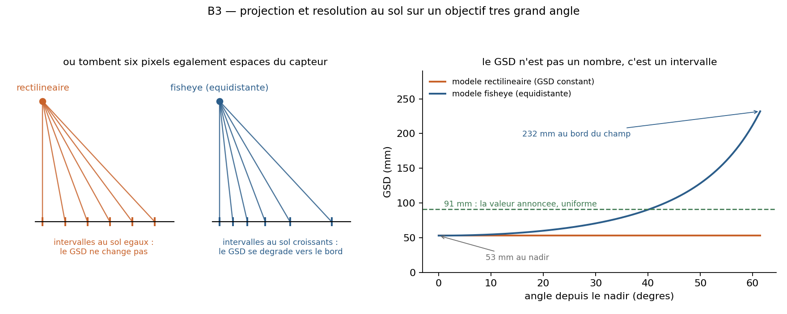
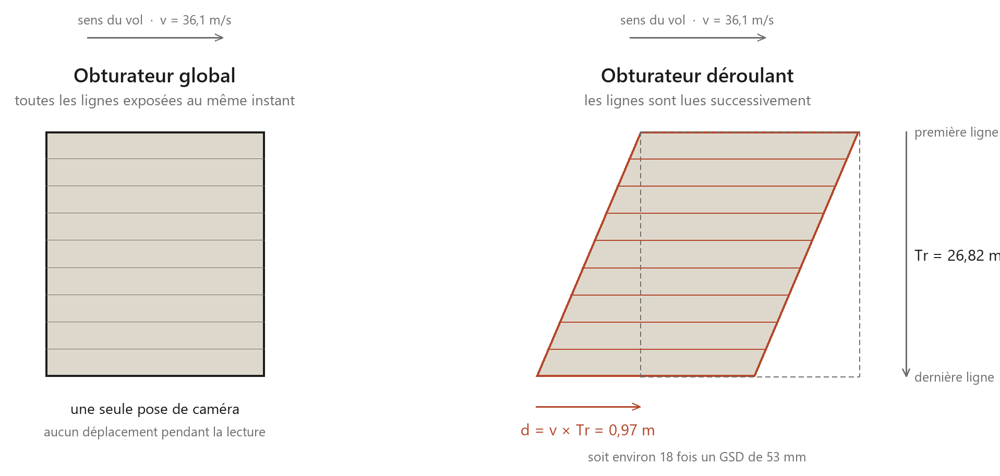
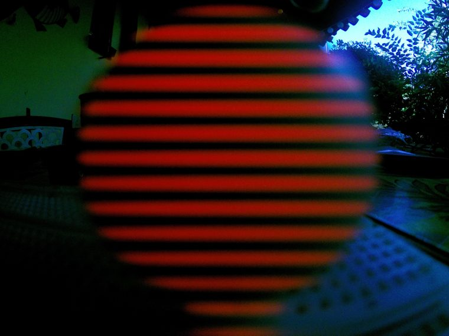
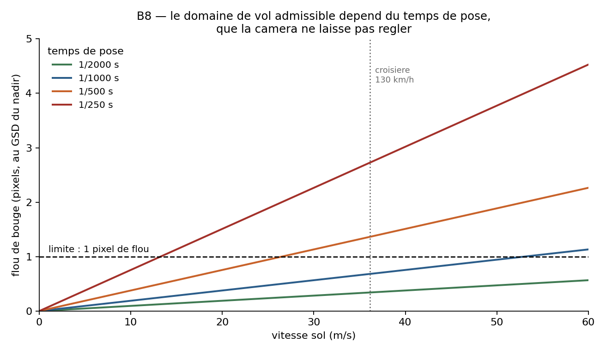

# Une GoPro peut-elle faire une orthophoto ? Mesurer le temps de lecture d'une caméra d'action

**Language / Langue :** 🇬🇧 [English](README.en.md) · 🇫🇷 Français

## Le point de départ

Une caméra d'action coûte quelques centaines d'euros, une caméra de
photogrammétrie plusieurs dizaines de milliers. La différence ne tient pas
seulement à la résolution : une caméra d'action ne donne pas d'emblée les
garanties géométriques nécessaires pour faire une carte.



**Figure 1 — Projection rectilinéaire et modèle fisheye : le GSD varie dans le
champ.** Les valeurs 53 mm et 232 mm sont calculées pour la configuration
représentée, non mesurées sur une orthophoto. Calculs de l'auteur.

La question de ce dépôt est donc simple :

> **une GoPro peut-elle prendre une série d'images dont on tire une orthophoto,
> et dans quelles conditions ?**

Pour y répondre, il manque une valeur que l'on ne trouve nulle part : le **temps
de lecture du capteur**. La plupart des caméras d'action ne prennent pas toute
l'image d'un coup : elles lisent le capteur ligne par ligne, de haut en bas
(c'est l'obturateur déroulant, ou *rolling shutter*). Si la caméra bouge pendant
cette lecture, l'image est déformée. OpenDroneMap sait corriger cette
déformation, mais à condition de connaître le temps de lecture, et il n'a aucune
valeur pour la HERO4 Silver ni pour la HERO13 Black. Prendre la valeur d'un
autre modèle, c'est supposer que deux capteurs se lisent de la même façon.



**Figure 2 — Lecture simultanée ou successive du capteur.** À 36,1 m/s, une
lecture de 26,82 ms correspond à 0,97 m de déplacement de la plateforme ; cette
distance n'est pas l'erreur mesurée sur l'orthophoto. Schéma et calculs de
l'auteur.

J'ai donc construit un banc de mesure. Ce dépôt contient le banc, son protocole,
les programmes qui analysent les photos, les valeurs obtenues, et un vol test
qui vérifie le résultat en conditions réelles.

## Le principe du banc

Une diode clignote à une fréquence connue. Comme les lignes du capteur sont lues
les unes après les autres, chaque ligne voit la diode dans un état différent
(allumée ou éteinte). La photo montre alors des bandes horizontales. En comptant
les bandes sur la hauteur de l'image, on retrouve la durée entre la lecture de
la première ligne et celle de la dernière :

$$t_{\text{lecture}} = \frac{N}{f}$$

où *N* est le nombre de bandes comptées sur la hauteur de l'image et *f* la
fréquence de la diode.



**Figure 3 — Banc à diode pour mesurer le temps de lecture de la
HERO4 Silver.** Les bandes lumineuses renseignent le décalage temporel entre les
lignes du capteur ; protocole détaillé en
[annexe B](docs/annexes.md#annexe-b--protocoles-de-mesure-reproductibles).
Cliché de l'auteur.

Le principe est simple, mais les conditions pour que ça marche ne vont pas de
soi : il m'a fallu trois séries ratées avant d'obtenir la première mesure
utilisable.

## Ce que j'ai mesuré

| Caméra | Mode de prise de vue | Temps de lecture |
|---|---|---|
| GoPro HERO4 Silver | photo unique, champ large, 12 Mpx | **27,01 ms** |
| GoPro HERO4 Silver | photo unique, champ moyen, 7 Mpx | **18,29 ms** |
| GoPro HERO4 Silver | Time Lapse 1 s | **26,9 ms** |
| GoPro HERO13 Black | Wide et Linear, 27 Mpx | **20,8 ms** |

Le résultat le plus important : **le temps de lecture dépend du champ de vue
choisi, pas de la résolution du fichier.** En champ large, 12 Mpx et 7 Mpx
donnent la même valeur à un demi pour cent près (27,01 et 26,86 ms). En champ
moyen, on perd un tiers (18,29 ms) : le capteur ne lit alors qu'environ 68 % de
sa hauteur, et la résolution n'est qu'une réduction faite après la lecture.

À garder en tête : une valeur de temps de lecture ne doit jamais être donnée
pour un modèle de caméra seul, sans préciser le mode de prise de vue.

## Le banc, dans votre navigateur

👉 **[Ouvrir le banc](https://renouxfabrice.github.io/action-camera-orthophoto-validation/banc/)**

Rien à installer : le banc règle la cadence de la diode, guide la prise de vue,
enregistre les mesures et tient le journal de la séance. La
[fiche de terrain](banc/fiche_terrain.html) en est la version imprimable.

## Trois choses à savoir avant de monter le banc

**La diode doit être la seule lumière de la pièce.** En plein jour, la diode
n'est qu'un objet blanc éclairé par le soleil, et aucune bande n'apparaît.

**Il faut relever la sensibilité minimale, pas la baisser.** C'est le réglage le
moins évident, et le plus important. Laissée en automatique, la caméra choisit
un temps de pose long avec une sensibilité basse, ce qui efface les bandes. En
lui interdisant de descendre sous 800 ISO, on l'oblige à raccourcir le temps de
pose. Sur la HERO13 Black en mode linéaire, ce seul réglage fait passer l'écart
entre les quatre cadences de 5,40 % à 0,80 %, soit sept fois mieux (voir le
[tableau B.5](docs/annexes.md#b6-résultats-du-banc--les-campagnes-de-septembre-2026)).
Ce n'est pas un effet du nombre de photos : la série la plus fournie est la
moins bonne.

**Un pic dans un spectre n'est pas forcément une bande.** Trois contrôles
permettent de distinguer une vraie mesure d'un artefact ; ils sont décrits en
[annexe B.1.2](docs/annexes.md#b12-les-trois-contrôles-qui-distinguent-une-mesure-dun-artefact).

## Refaire les mesures

Les séances complètes pèsent 5,7 Go et ne sont pas dans le dépôt. Il contient un
échantillon de dix photos par série, ce qui suffit pour retrouver chaque valeur.
Pendant les séances, la carte faisait défiler seule ses quatre cadences :
`balayage.py` retrouve après coup la cadence utilisée pour chaque photo, sans
qu'on ait besoin de la noter.

```bash
python src/balayage.py data/echantillon/hero4_champ_large_12mpx
python src/balayage.py data/echantillon/hero4_champ_large_7mpx
python src/balayage.py data/echantillon/hero4_champ_moyen_7mpx
python src/balayage.py data/echantillon/hero13_wide
python src/balayage.py data/echantillon/hero13_lineaire_iso_auto
python src/balayage.py data/echantillon/hero13_lineaire_iso800
```

| Échantillon | Caméra | Réglage | Vues | Photos | Séance complète | Échantillon |
|---|---|---|---|---|---|---|
| `hero4_champ_large_12mpx` | HERO4 Silver | large, 12 Mpx | — | 10 sur 121 | 27,01 ms | **26,9 ms** |
| `hero4_champ_large_7mpx` | HERO4 Silver | large, 7 Mpx | `GOPR3806–3914` | 10 sur 109 | 26,86 ms | **26,9 ms** |
| `hero4_champ_moyen_7mpx` | HERO4 Silver | moyen, 7 Mpx | `GOPR3557–3805` | 10 sur 249 | 18,29 ms | **18,3 ms** |
| `hero13_wide` | HERO13 Black | Wide, 27 Mpx | `GP010377–0446` | 10 sur 70 | 20,73 ms | **20,8 ms** |
| `hero13_lineaire_iso_auto` | HERO13 Black | linéaire, ISO auto | `GP010450–0508` | 10 sur 59 | 20,80 ms | **20,6 ms** |
| `hero13_lineaire_iso800` | HERO13 Black | linéaire, ISO 800 | `GP010509–0574` | 10 sur 66 | 20,96 ms | **21,0 ms** |

Les deux séances du 23 septembre 2026 portent le résultat principal (même
caméra, deux champs de vue). Les deux démonstrations du banc, l'effet du champ
de vue et l'effet de la sensibilité minimale, se refont entièrement avec cet
échantillon.

> **L'horloge de la HERO13 n'était pas réglée** : toutes ses photos sont datées
> du 5 janvier 2016. Les trois séries se distinguent donc par les numéros de
> vues indiqués dans le tableau.

Une seule séance est incomplète : la HERO13 Black en champ Wide. La carte
mémoire ne contient que 70 photos sur 229 (vues 0377 à 0446) ; les 159 premières
sont perdues. Les 70 disponibles donnent 20,8 ms, et le journal de séance
indiquait 20,73 ms sur les 229.

## Le vol test : ce qu'il montre, et ce qu'il ne montre pas

Le 24 septembre 2026, une HERO4 Silver en Time Lapse d'une seconde a volé sous
un drone DJI Matrice 600. Les 226 images ont été assemblées en un seul bloc, et
le traitement a produit une orthophoto de 2,89 ha.

Sur la position, l'écart avec les points mesurés au sol est de **4,5 m** avant
recalage. Mais après une simple correction de position, d'orientation et
d'échelle (une similitude), il ne reste que **0,49 m**. Autrement dit, le bloc
d'images est bien plus cohérent que ce que laisse penser son positionnement :
c'est le positionnement, et non la caméra, qui limite le résultat.



**Figure 4 — Flou de bougé en fonction de la vitesse et du temps de pose.** La
ligne horizontale à un pixel marque le seuil au-delà duquel le déplacement
pendant la pose commence à effacer le détail que le GSD laisse espérer.

Ce vol ne valide ni la HERO13 Black, ni la MISSION 1 PRO ILS, ni l'usage en
avion léger. Les vitesses et hauteurs de vol calculées pour les autres modes
restent des hypothèses à tester en vol.

## Ce que contient le dépôt

| Dossier | Contenu |
|---|---|
| [`docs/methode.md`](docs/methode.md) | Le document complet : les cinq défauts d'une caméra d'action, la distorsion, l'obturateur déroulant, les vitesses et hauteurs de vol possibles, et le vol test |
| [`docs/annexes.md`](docs/annexes.md) | Les formules et le protocole détaillé, y compris les cas où la mesure échoue |
| [`banc/`](banc/) | Le banc en HTML, la fiche de terrain et le programme de la carte Arduino |
| [`src/`](src/) | `mesurer_readout.py` mesure le temps de lecture sur une photo ; `balayage.py` retrouve la cadence utilisée ; `banc_gopro.py` pilote la caméra en wifi |
| [`docs/protocols/`](docs/protocols/) | Chambre noire, réglages selon la génération de caméra, et méthode pour un modèle inconnu |
| [`hardware/`](hardware/rolling_shutter_bench/) | Le montage de la carte et les deux programmes Arduino |
| [`tables/`](tables/) | Les tableaux du document, en CSV |
| [`data/`](data/) | Les journaux des sept séances et l'échantillon de photos |

## Comment ce travail a été fait

J'ai conçu le banc, fait les mesures, le vol test et les vérifications. Pour
écrire et corriger le code, analyser les données et rédiger la documentation, je
me suis fait aider par un outil d'intelligence artificielle, Claude (Anthropic).
J'ai relu le code et les textes, et les valeurs publiées se retrouvent à partir
de l'échantillon fourni. Les erreurs qui resteraient sont les miennes :
n'hésitez pas à les signaler.

## Licence

Le code est sous licence [MIT](LICENSE). Les photos et les figures sont de
l'auteur.

## Contact

**Fabrice Renoux** — [@renouxfabrice](https://github.com/renouxfabrice)

Pour signaler une erreur ou proposer une mesure sur une autre caméra, le plus
simple est d'ouvrir une *issue*. Les temps de lecture d'autres caméras sont les
bienvenus : c'est justement ce qui manque aujourd'hui.
